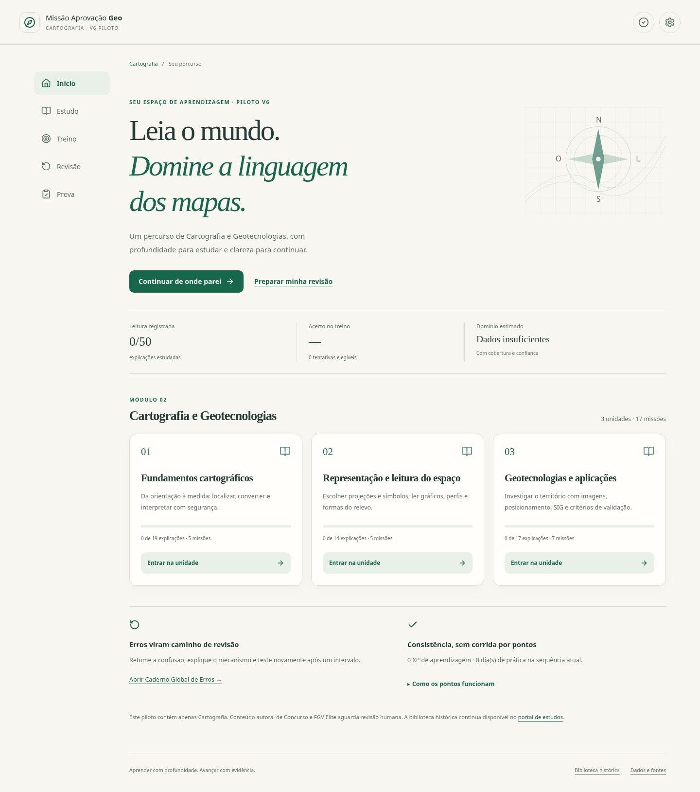
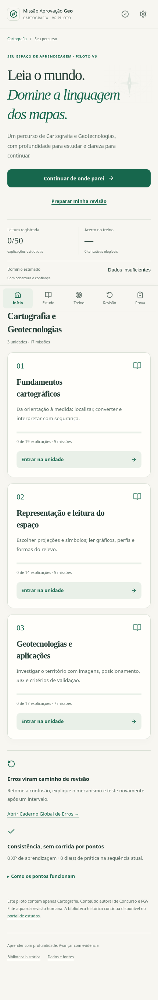
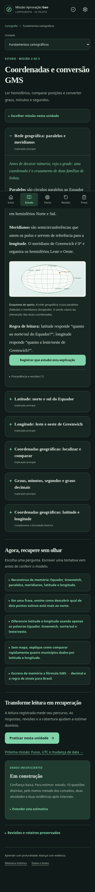

# V6 — Fase 14: Auditoria Premium do piloto

Data: 15/10/2026. Objeto: somente Cartografia e Geotecnologias na branch `v6-piloto-cartografia`.

**Parecer:** implementação pronta para avaliação humana. A conferência técnica de preservação e os testes passaram; **o aceite Premium e pedagógico humano continua pendente**. Esta é uma autoauditoria documentada da implementação, não uma certificação independente da banca.

Evidências: [paridade final](V6_FASE14_RELATORIO_PARIDADE.md), [manifesto por registro](V6_FASE14_PARIDADE.json), [relatório de testes](V6_FASE14_RELATORIO_TESTES.md) e [guia de execução/revisão](V6_FASE14_GUIA_PILOTO.md).

## Matriz de verificação

| Critério | Implementação e evidência | Situação e limite |
| --- | --- | --- |
| Escopo e autoridade | Issue #12, handoff e 18 documentos obrigatórios lidos; mapa registrado antes do código; três unidades canônicas | Escopo respeitado; nenhum outro módulo migrado |
| Preservação | 50 explicações, 125 questões, 150 cards, 300 V/F, 39 recalls e suplementos das fontes com originais e hashes | Comparação por registros passou; revisão semântica humana final pendente |
| Consolidação | 17 missões; redundâncias em variantes/aliases, teoria complementar identificada | Sem concatenação de três páginas inteiras ou metas artificiais de quantidade |
| Densidade de teoria | Textos, exemplos, tabelas e explicações históricas integrais; detalhes progressivos | Sem redução para facilitar programação |
| DNA visual V5 | Inter/Literata, fundo quente, verde, âmbar discreto; coluna de leitura confortável | Capturas inspecionadas; sem estudo de preferência com usuários |
| Mobile-first | Navegação de cinco destinos, ações ≥44 px nos controles principais, cards e leitura em coluna | Fluxos em 360/390/430 px passaram; dispositivos físicos não testados |
| Divulgação progressiva | Uma missão, questão ou cartão ativo; mapas de missão, fontes, teoria complementar e explicações extensas recolhíveis | Reduz quantidade de controles simultâneos sem esconder a existência do conteúdo |
| Ambientes | Estudo/Treino/Revisão/Prova separados, unidade ativa e retomada | Navegação e reload verificados |
| Feedback universal | Resultado, explicação, mecanismo, exemplo, confusão provável e recuperação; comparação por alternativa | Motor presente em todos os formatos; escrita/prática usam modelo e autoavaliação formativa |
| Banco e A–E | 125 Fixação legadas; 18 Concurso e 18 Elite autorais; opções por IDs; fonte/status explícitos | Itens novos em `human-review-pending`; nenhum inventado como questão oficial |
| Qualidade Elite | Integração de escala/época/precisão, coordenadas, fusos, representação, validação, incerteza e aplicação escolar; distratores técnicos revisados | Dificuldade/cognição são classificações editoriais; exigem revisão humana e dados de uso |
| Diagnóstico/pós | Mesmo conjunto de IDs por unidade e comparação ao concluir | Não confunde melhora imediata com retenção |
| Flashcards | Tentativa antes do verso; quatro avaliações; agenda por cartão; prioridade de vencimento e lapsos | Heurística transparente, sem alegar algoritmo clinicamente validado |
| Retorno de erros | Cada Errei volta uma vez à fila; até 12 iniciais +12 retornos; vencimento de 1 dia | Se não houver outros itens entre tentativas, a interface recomenda pausa; repetição próxima não conta como retenção |
| Game V/F | Decisão seguida de justificativa, formulação correta para falso, mecanismo, exemplo e retorno à teoria | Sem transformar afirmações aleatórias em prova A–E |
| Chefão | Papel histórico preservado, banco rastreável e feedback completo | Não promove item simples a Elite só pelo rótulo |
| Caderno global | Conceito/confusão, oito tipos E1–E8, histórico, recorrência, prioridade, filtros e classificação ajustável | Auto-classificação inicial é sugestão, não diagnóstico de causa do erro |
| Recuperação | Feedback não resolve erro; exige acerto tardio; domínio após erro exige contexto distinto, revisões consistentes e intervalo | Regra testada com relógio controlado; não é evidência longitudinal real |
| Domínio/confiança | 45% respostas +30% retenção +15% recuperação +10% cobertura; condições mínimas antes de número | Heurística de treino; XP/leitura fora da nota; sem previsão de aprovação |
| XP sem farming | Ledger por ação significativa, revisão realmente vencida, melhora após intervalo e primeira conclusão por critério | Sem XP por abrir/rolar/virar; autorrelato não possui proteção contra adulteração voluntária do armazenamento local |
| Dark/movimento | Sistema e escolha manual; `prefers-reduced-motion` e redução manual | Preferências e transições testadas |
| Teclado | Controles nativos, rádio por setas, confirmação por Enter, skip link e foco nas mudanças de contexto | Fluxos testados; auditoria completa com leitores de tela ainda pendente |
| Prova | Banco A–E próprio, diversidade/novidade, relógio absoluto, seleção salva e feedback só ao encerrar | Prova do módulo experimental; perfil oficial completo bloqueado por estoque aprovado insuficiente |
| Blueprint reutilizável | Motor genérico recebe cotas/áreas/itens aprovados; fixture monta as 60 posições do perfil | Sem conteúdo fictício de outras disciplinas no produto |
| Discursiva | Quatro propostas históricas +duas de representação; tentativa antes do modelo, rascunho, histórico e rubrica | Contagem de linhas estimada; rubrica não é espelho oficial; não há nota automática de qualidade |
| Prática | Plano manuscrito orientado, defesa oral com quadro/marcador, sequência, timer, campos e rubrica 4+6 | Tempos são de treino configurável; autoavaliação não substitui banca |
| IDs e procedência | Registro congelado, variantes, hashes, `legacy_source`/`legacy_id`; alternativas independentes da posição | Mudanças futuras de identidade exigem migração explícita |
| Migração | Opcional, explícita, idempotente, bruto preservado, versões ambíguas isoladas | Sem inferir datas, XP, domínio ou conclusão; v25 sem interpretação automática |
| Resiliência | Backup, restauração, recuperação, validação, aviso de quota e atualização entre abas | Sem sincronização em nuvem ou transação atômica de duas abas simultâneas |
| Testes | 39 integridade/motor +54 navegador, build e geração reproduzível aprovados | Não representam validação humana do aprendizado ou teste completo de todas as combinações |

## Achados e decisões relevantes

### Preservação e conteúdo

Não foi identificada perda pedagógica no confronto por registro das três fontes. A versão secundária de T03 contribuiu apenas com `C_49`, `G_96` e `G_87`. A cópia das discursivas de T02 em T03A foi tratada como alias, preservando seis procedências e quatro propostas históricas distintas.

Foi encontrada redundância numérica nos distratores de T02 `b_6_0`: `−42,3°` e `−42,30°`. Ambos estão errados; a conversão correta é `−42,5°`. O caso está sinalizado e explicado, preservado só em Fixação e excluído da prova. Isso merece decisão editorial humana futura; não foi escondido sob uma alegação de “zero duplicatas”.

As classificações D1–D4/C1–C5 dos itens novos são editoriais. A classificação conservadora do legado como Fixação preserva a função de ensino sem inflar estoque de concurso. O novo banco não contém questões oficiais reproduzidas e não simula procedência FGV.

### Progresso e métricas

Fusão de cartões não soma domínio ou multiplica recompensas. `ok/rev` antigos não comprovam retenção: viram revalidação. A chave compartilhada de T03 impossibilita saber automaticamente qual edição gerou determinados índices; esses registros ficam como versão incerta. A cópia bruta é mantida para recuperação humana.

O caderno considera erros e recuperações de diferentes ambientes. Rascunhos, respostas, revisões, provas e rubricas ficam no mesmo envelope autoritativo; o caderno global também possui espelho por módulo. Estado corrompido ou falha de quota produz aviso explícito, sem prometer gravação que não ocorreu.

Mastery e XP são dimensões separadas. A política de confiança exige diversidade, cobertura e intervalo, mas ainda precisa de calibração com alunos. Não se entrega indicador de “prontidão para aprovação” com base neste piloto isolado.

### Fontes e mídia

As quatro imagens históricas externas consultadas responderam. Diversos endpoints IBGE recusaram a ferramenta com 403; sua disponibilidade não foi confirmada nem classificada como 404. Há fallback textual e fontes preservadas. O piloto não é um aplicativo offline completo.

O banco com originais e variantes é carregado como JSON do módulo, aproximadamente 1,36 MB sem compressão. A arquitetura admite divisão futura por unidade; nesta fase a preservação e a auditoria reproduzível têm prioridade. Não foram feitas promessas de desempenho em redes móveis sem medição.

## Evidências visuais

Capturas da build, com recursos externos bloqueados nos testes; as fontes podem aparecer com fallback. Foram inspecionadas para hierarquia, leitura, dark mode e navegação, sem afirmar validação de usabilidade com alunos.

## Sugestões para qualificação após revisão humana

1. Revisar os 36 itens novos, o cartão de áreas e as duas discursivas; confirmar plausibilidade dos distratores, gabarito único, dificuldade e alinhamento ao edital. Só depois promover itens ao pool oficial.
2. Decidir a substituição futura do distrator redundante de GMS, mantendo original, alias e histórico. Examinar as variantes semânticas de cards/Game com professor revisor para confirmar todas as fusões.
3. Fazer um teste acompanhado com candidatos em celular e com leitor de tela; verificar compreensão da agenda, da confiança e dos estados de erro, além da densidade da teoria.
4. Revalidar mídias externas em navegador comum e considerar distribuição local/licenciada dos recursos para maior independência de terceiros. Preservar fontes e descrições.
5. Acompanhar uso real antes de ajustar intervalos, pesos ou limiares. Fazer qualquer calibração com versionamento e histórico, sem apagar progresso.

Essas recomendações não autorizam expansão para outros módulos, merge ou publicação. O piloto está entregue para avaliação; a implementação deve parar nesta fase e aguardar aprovação humana.
