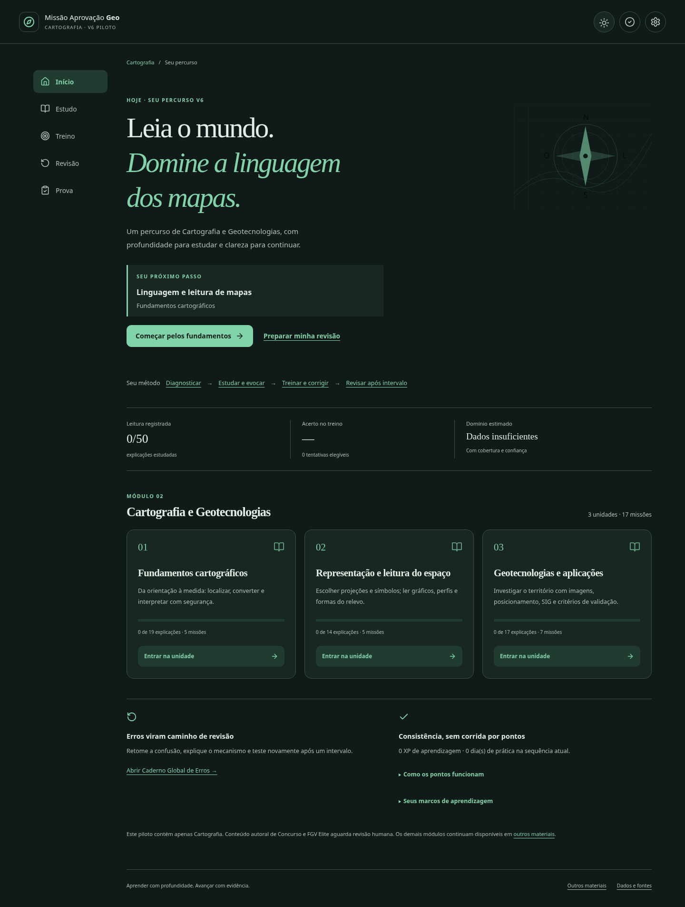
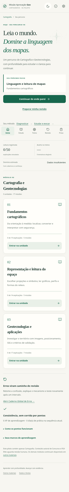
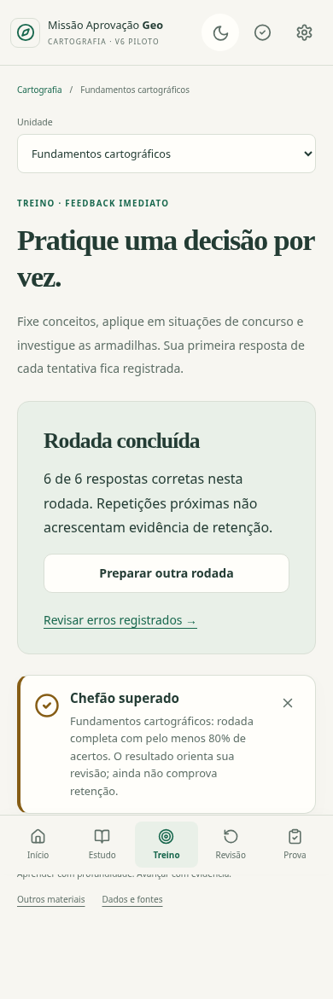

# V6 — Fase 14: segunda rodada de correções

Data: 15/10/2026. Branch exclusiva: `v6-piloto-cartografia`.

**Situação atualizada: visual e teste de uso aprovados pelo usuário; P1/P3 corrigidos e reconferência recebida sem bloqueador técnico remanescente nesse escopo.** Ver o [registro do aceite e próximos passos](V6_FASE14_ACEITE_USO_E_PROXIMOS_PASSOS.md) e o [parecer posterior](V6_FASE14_RECONFERENCIA_P1_P3.md). A revisão editorial dos itens autorais continua pendente. Não houve merge, publicação ou migração de outro módulo. A auditoria independente e a rejeição inicial de UX permanecem registradas integralmente.

Esta rodada atende a [auditoria independente](V6_FASE14_AUDITORIA_INDEPENDENTE.md), o [feedback de uso real](V6_FASE14_FEEDBACK_USUARIO.md) e os comentários atualizados da Issue #12, incorporados dos commits `d285bf3` e `5fab5d1`. Os resultados da primeira entrega não são tratados como aprovação do usuário.

## Entrada e legado fora do percurso ativo

- `/` e `/index.html` abrem diretamente a experiência V6. `/v6.html` continua funcionando como alias da mesma aplicação, com os mesmos IDs e progresso na mesma origem.
- A primeira tela apresenta a próxima missão ou os cartões vencidos, uma ação principal e o percurso Diagnosticar → Estudar e evocar → Treinar e corrigir → Revisar após intervalo.
- As três unidades canônicas são as únicas entradas de Cartografia: Fundamentos cartográficos, Representação e leitura do espaço e Geotecnologias e aplicações.
- Os 26 materiais dos demais módulos continuam acessíveis em `/biblioteca.html`. Eles não foram migrados para V6 nem tiveram seus HTMLs alterados.
- Os quatro registros históricos de Cartografia saíram do catálogo ativo: não participam de busca, cards, favoritos visíveis, retomadas, recomendações ou contagens dessa biblioteca. A versão não auditada não recebe link de estudo dentro de outra edição.
- `content/archive-catalog.json` preserva as quatro descrições históricas e os totais completos para auditoria. O catálogo ativo contém apenas os identificadores, hashes e chaves necessários para incluir o progresso arquivado no backup, sem títulos ou links de estudo desse legado.
- URLs antigas de Cartografia passam a abrir a unidade canônica correspondente. URLs antigas de outros módulos continuam abrindo os materiais anteriores. Nenhuma resposta histórica é interpretada automaticamente como resposta V6.
- Fontes e arquivos integrais continuam consultáveis na área de procedência/auditoria, fora da navegação principal de estudo.

Os totais históricos continuam sendo 31 HTMLs, 30 registros de estudo, 542 etapas, 1.327 questões, 1.494 cartões, 3.000 V/F e 452 recalls. O catálogo auxiliar ativo de outros módulos tem 26 registros, 475 etapas, 1.160 questões, 1.294 cartões, 2.600 V/F e 396 recalls. Esses totais não se somam aos recursos canônicos V6 como se fossem conteúdo novo.

## Embalagem editorial e percurso

Foram feitas sete alterações de apresentação em `scripts/v6-editorial.mjs`, registradas individualmente em `cartografia.json → editorialChanges`:

1. Título do guia de fundamentos, antes “Como a FGV cobra Cartografia I”.
2. Transição para projeções, antes “Ponte para Cartografia II” e “na próxima página”.
3. Referência ao estudo de UTM, agora ligada à missão correspondente.
4. Título do guia de representação e geotecnologias.
5. Abertura desse guia, substituindo o nome editorial antigo pela área conceitual.
6. Comando de recall de fundamentos.
7. Comando de recall de finalidade da representação/geotecnologias.

Não houve resumo de teoria, troca de exemplos, alteração de gabaritos ou redução dos bancos. A redação original integral permanece em `archive[].original`, com o mesmo hash e procedência. A camada publicada passa a usar unidade/missão, sem “Cartografia I/II” como identidade estrutural.

Após registrar uma explicação, o estudante pode testar o raciocínio daquela missão; o treino realmente abre com o filtro correspondente. A tela inicial também recomenda até três conceitos do caderno de erros. “Diagnosticar” abre o banco de diagnóstico, não uma lista genérica de Fixação.

## Temas e microcelebrações

O cabeçalho oferece alternância direta claro/escuro, persistente e compatível com a preferência do sistema. Inter/Literata, verde, fundo quente e âmbar discreto continuam sendo o DNA visual aprovado; não foi criada uma coleção arbitrária de paletas por módulo.

Microcelebrações curtas reconhecem:

- percurso de unidade com todas as explicações registradas e recuperação em cada missão;
- Chefão completo da unidade com pelo menos 80% de acertos;
- cartões realmente vencidos colocados em dia;
- erro convertido em domínio pelas regras de recuperação já existentes;
- marcos de 3, 7, 14, 30, 60 e 90 dias de prática significativa.

O critério de 80% é uma convenção formativa do piloto, não nota oficial, domínio automático ou previsão de aprovação. “Percurso concluído” também não é sinônimo de retenção ou domínio.

Os marcos ficam no campo opcional `milestones` do envelope de progresso. Não se repetem por reload ou pela repetição do mesmo Chefão; a apresentação não concede XP adicional. O histórico fica em área recolhível. Não há celebração a cada alternativa. A animação usa entrada de 6 px e check breve, sem som, vibração ou confete. Redução de movimento automática/manual desativa as animações. O aviso aparece no fluxo depois da atividade, sem cobrir botões ou links; é dispensável por teclado, não recebe foco automaticamente e não aparece na área Prova.

## Correções da auditoria técnica

### B1 — gabarito previsível

Falha anterior preservada no histórico: a posição correta seguia `i % 5`, produzindo A→B→C→D→E. O teste antigo verificava equilíbrio e deixava passar o padrão previsível.

Agora a prova gera uma sequência embaralhada por sessão, equilibrada entre A–E, rejeitando periodicidade completa de períodos 1–5 e sequências de três posições iguais. Os distratores também são embaralhados. A ordem é gerada uma única vez e salva em `optionOrder`; reload não muda o gabarito nem as alternativas exibidas. Uma seed explícita permite reprodução em teste; a sessão normal usa identidade aleatória nova.

O teste derivado da especificação verifica 160 montagens com tamanhos 5/10/20/30, equilíbrio, ausência daqueles padrões, diversidade entre seeds, reprodução e persistência. Isso não equivale a uma certificação estatística universal da aleatoriedade.

### B2 — semântica de Difícil

Falha anterior: `Difícil` era enviado como `correct=false`, abrindo ou reativando erro conceitual. Agora somente `Errei` é recuperação incorreta. `Difícil` registra sucesso com esforço, intervalo inicial de dois dias e nenhum lapso novo. Não abre, reabre ou aumenta a contagem de erros; tampouco resolve um erro objetivo sozinho.

A retenção atribuída a uma recuperação tardia marcada Difícil tem metade do crédito de Bom/Fácil na heurística de domínio. O intervalo curto e o rating individual continuam registrados; não se trata Difícil como estabilidade plena. Esta ponderação é operacional e ainda exige calibração com uso real.

### C1 — dia civil

Falha anterior: dias eram calculados em UTC e a sequência recuava em blocos de 24 horas. Agora usa a data local do navegador e recua por dias de calendário. Os intervalos de revisão continuam usando tempo decorrido; essa correção é específica do calendário de consistência.

Estados V6 anteriores sem `calendarPolicy` conservam os dias UTC em `legacySignificantDays`; os dias locais são reconstruídos somente de evidências elegíveis e registros datados de escrita/prática. Dias sem timestamp comprobatório não são atribuídos a uma data local por adivinhação. A migração é idempotente, não cria XP ou respostas e mantém os registros originais.

Há testes de fronteira da meia-noite em America/Sao_Paulo e mudança de offset em America/New_York. Um teste de navegador usa 23h30 e 0h05 locais para verificar que são dois dias civis distintos.

### Restauração

Restaurar uma cópia agora também remove campos opcionais ausentes dela, depois de preservar `.before-restore`. Isso evita manter uma sessão ou um marco da sessão atual que não fazia parte do backup restaurado.

## Preservação e limites

- Mesmos 685 registros de paridade, 50 explicações, 161 questões, 120 cartões, 256 V/F, 39 recalls e 6 propostas discursivas.
- Os 31 HTMLs permanecem byte a byte iguais ao inventário. Nenhum gabarito histórico foi reescrito.
- O backup auxiliar continua incluindo as 30 fontes de estudo e as chaves de Cartografia, mesmo sem exibi-las como opções ativas.
- Provas já criadas na versão anterior mantêm sua ordem salva para não alterar uma tentativa em andamento; a distribuição corrigida aplica-se a novas provas.
- Evidências/erros históricos de um uso anterior de Difícil não são apagados ou reinterpretados silenciosamente nesta rodada. A correção governa as novas avaliações; o efeito de eventual histórico de teste anterior deve ser considerado na revisão humana do caderno e das métricas.
- Os 36 itens novos continuam `human-review-pending`; prova oficial completa continua bloqueada por estoque aprovado insuficiente.
- Permanecem os limites de armazenamento local, mídia externa, revisão pedagógica humana e testes em dispositivos físicos registrados nos relatórios anteriores.

## Verificação e nova avaliação

Capturas da prévia desta branch, com recursos externos bloqueados para reproduzir a verificação local:

Os resultados vigentes estão no [relatório de testes](V6_FASE14_RELATORIO_TESTES.md) e na evidência `v6-evidencias/resultado-rodada2.json`.

Roteiro de aceite humano: abrir a raiz da prévia desta branch, verificar a diferença para a biblioteca antiga, percorrer as três unidades, alternar tema, passar de uma explicação ao treino da mesma missão, avaliar Difícil e revisar a experiência de Chefão/revisão. Verificar que Cartografia II não aparece duplicada em nenhum catálogo ativo.

**Parar nesta rodada.** O usuário já aprovou o visual e o teste de uso. A reconferência técnica P1/P3 foi recebida sem bloqueador remanescente nesse escopo; a revisão editorial dos itens autorais continua pendente. Não há autorização de merge, publicação ou expansão para outro módulo; este registro não encerra a Issue #12.
