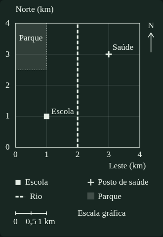

# Cartografia 0.1.2 — explicações específicas e exercício cartográfico autossuficiente

Data: 16/10/2026. Branch: `v6-base-canonica`.
Implementação verificada: `07337379186fe597cab54717e167f6b61c0d0ca1`.
Origem preservada: candidatas `0.1.1`, presentes em `adf8265db8e9e92dd5ebac5942d99674882b0afd`.

## Resultado

Foram corrigidas as melhorias identificadas na [revisão delegada ao assistente](V6_ISSUE13_REVISAO_DELEGADA_CARTOGRAFIA.md): 44 questões legadas receberam explicações específicas de 137 alternativas incorretas; o exercício de leitura ganhou um mapa didático autossuficiente; e `v6-q-r11` foi reclassificada para Concurso/D2/C3.

A revisão editorial foi conduzida pelo Codex por delegação do usuário, sem exigir leitura manual de questões no GitHub. O parecer por IA está registrado e vinculado aos hashes dos recursos. Não se atribui ao usuário uma leitura que ele não realizou e não se simula certificação humana externa.

Build, **101 testes**, **25 recálculos independentes** e **quatro cenários isolados de navegador** passaram. Os [resultados e limites dos testes](V6_ISSUE13_TESTES_CARTOGRAFIA_012.md) distinguem a validação do novo material dos testes anteriores da plataforma.

Esta rodada modifica as candidatas e sua infraestrutura de validação. **O aplicativo ainda não consome `0.1.2` e o site publicado não foi alterado.** Não houve merge, publicação ou migração de outros módulos.

## O que mudou no conteúdo

| Unidade | Questões com explicações aprimoradas | Alternativas incorretas explicadas |
| --- | ---: | ---: |
| Fundamentos | 10 | 31 |
| Representação | 11 | 34 |
| Geotecnologias | 23 | 72 |
| Total | **44** | **137** |

Os prefixos repetitivos “Distrator.”, “Não atende ao comando.” e “Não é a melhor resposta.” deram lugar à explicação do engano concreto: fator de conversão, variável confundida, operação inadequada ou limite de inferência. Os feedbacks da alternativa correta, enunciados, opções, IDs e explicações centrais foram preservados.

Por exemplo, o item que usa 4 cm em 1:500.000 agora distingue perder um fator dez, acrescentar um fator dez e acrescentar um fator cem. No item de declividade, a alternativa 20° é contrastada com a razão de 20% e seu ângulo aproximado de 11,3°. Não foram apenas removidos os rótulos genéricos.

`v6-q-r11` mantém integralmente enunciado, opções e resposta sobre adequação da base cartográfica à medição local. A classificação passou de Elite/D3/C5 para Concurso/D2/C3, porque o comando aplica um critério conhecido e os distratores são relativamente distantes da resposta. O conjunto passa de 125 Fixação / 23 Concurso / 13 Elite para **125 Fixação / 24 Concurso / 12 Elite**. Não há calibração psicométrica nem aumento artificial do estoque aprovado de prova.

## Mapa e fusos

O exercício obrigatório de leitura deixa de depender de um PDF externo que as ferramentas não conseguiram conferir. O novo mapa de **Horizonte**, explicitamente hipotético, contém:

- grade local de 0 a 4 km em cada eixo;
- escola, posto de saúde, rio e parque com símbolos e rótulos distintos;
- norte indicado, legenda e barra gráfica de 1 km;
- coordenadas e dados geométricos estruturados;
- tabela e descrição textual equivalentes;
- atribuição de elaboração didática, sem fingir fonte territorial oficial.

A escola está em E=1 km/N=1 km, o posto em E=3 km/N=3 km e o rio em E=2 km. A barra gráfica tem exatamente o comprimento de um lado da quadrícula. A grade não é latitude/longitude e não delimita municípios ou fusos brasileiros. A atividade mantém leitura de título, legenda, orientação, escala, referência e fonte.

O exemplo numérico de 1:40.000.000 permanece como exercício explícito: 1 cm corresponde a 400 km. Essa razão não é atribuída ao PDF não conferido nem ao novo desenho, cuja leitura usa sua própria barra gráfica. A referência a uma projeção policônica passa a depender de indicação efetiva no mapa consultado, em vez de afirmar um elemento não verificado do PDF.

A missão de fusos conserva o texto sobre os quatro deslocamentos brasileiros e recebe um quadro de horários calculados no mesmo instante: quando o Pará marca 14h em UTC−3, Fernando de Noronha marca 15h, Mato Grosso/MS 13h e Acre/oeste do Amazonas 12h. A configuração civil mantém o [Observatório Nacional](https://www.gov.br/observatorio/pt-br/assuntos/areas-de-atuacao/tempo-e-frequencia/brasil) e a [Lei 12.876/2013](https://www.planalto.gov.br/ccivil_03/_ato2011-2014/2013/lei/l12876.htm) como referências, com a ressalva da divisão interna do Amazonas.

O PDF IBGE e sua procedência foram preservados como leitura complementar. Seu acesso continua não concluído; não foi declarado verificado ou quebrado. O achado de dependência foi marcado `mitigated`, com justificativa: o exercício obrigatório tem agora suporte próprio verificável. Isso não transforma a tabela do ON em comprovação dos elementos gráficos daquele PDF.

## Preservação e comparação

| Recurso do conjunto | `0.1.1` | `0.1.2` |
| --- | ---: | ---: |
| Missões | 17 | 17 |
| Blocos de teoria | 50 | 50 |
| Recalls | 39 | 39 |
| Conceitos de apoio | 33 | 33 |
| Questões | 161 | 161 |
| Flashcards | 120 | 120 |
| V/F com justificativa | 256 | 256 |
| Discursivas | 6 | 6 |
| Suplementos | 6 | 6 |
| Identidades de recurso | 691 | 691 |
| Registros de procedência | 685 | 685 |

Os 161 enunciados, gabaritos e conjuntos de alternativas permanecem iguais. Flashcards, V/F, recalls, discursivas e suplementos não foram reescritos. Dos 50 blocos de teoria, 48 permanecem iguais; dois foram ampliados para acomodar o novo exercício e o quadro de fusos, preservando a fundamentação conceitual. Uma tabela de apoio foi acrescentada ao suporte estruturado do mapa; as quatro anteriores e o SVG de perfil continuam preservados.

As edições `0.1.0` e `0.1.1` não foram alteradas. A validação percorre agora toda a cadeia **`0.1.2 → 0.1.1 → 0.1.0`**, verifica hashes dos pais e rejeita alterações não declaradas e ciclos. As diferenças completas de conteúdo, suporte e metadados estão em cada `provenance.json#revision.changes`.

| Unidade | Parecer por IA | Comparação completa | Questões completas |
| --- | --- | --- | --- |
| Fundamentos | [Auditoria](../base-conhecimento/cartografia/cartografia-fundamentos/0.1.2/audit.md) | [Antes/depois](../base-conhecimento/cartografia/cartografia-fundamentos/0.1.2/changes.md) | [Questões](../base-conhecimento/cartografia/cartografia-fundamentos/0.1.2/review.md) |
| Representação | [Auditoria](../base-conhecimento/cartografia/cartografia-representacao/0.1.2/audit.md) | [Antes/depois](../base-conhecimento/cartografia/cartografia-representacao/0.1.2/changes.md) | [Questões](../base-conhecimento/cartografia/cartografia-representacao/0.1.2/review.md) |
| Geotecnologias | [Auditoria](../base-conhecimento/cartografia/geotecnologias/0.1.2/audit.md) | [Antes/depois](../base-conhecimento/cartografia/geotecnologias/0.1.2/changes.md) | [Questões](../base-conhecimento/cartografia/geotecnologias/0.1.2/review.md) |

## Parecer Premium e decisões técnicas

Cada pacote tem um parecer por IA nos 12 critérios. `assisted_review` identifica o responsável, a delegação, a versão, a fundamentação e os hashes do conteúdo, do suporte, dos metadados e de cada recurso. Uma mudança posterior invalida o vínculo. Esse registro não é uma assinatura digital nem uma certificação de especialista externo.

O novo tipo `schematic-map` tem validação de unidades, extensão, coordenadas, escala gráfica, alternativa textual e ausência de conteúdo ativo ou externo no SVG. O SVG armazenado precisa corresponder ao apresentado na teoria. O desenho é estático, herda as cores do tema e mantém suas proporções em telas pequenas.

O contrato anterior de promoção canônica continua separado do parecer por IA, sem preenchimento de campos humanos fictícios. As candidatas continuam `EM_AUDITORIA`, com consumo desativado. A adaptação desse contrato ao fluxo de revisão delegada e a integração do consumidor são trabalho técnico do assistente; não uma exigência de que o usuário audite manualmente o banco.

Permanecem como limites conhecidos: a ausência de calibração empírica de dificuldade; o acesso não concluído aos binários externos; o estoque insuficiente para a prova oficial completa; e a prática compartilhada de escala, ainda sem três propostas específicas implementadas. Nenhuma dessas limitações foi escondida por efeitos visuais ou convertida em aprovação automática.

Na próxima integração, o consumidor deverá registrar versão editorial das evidências, respeitar famílias de questões, manter o histórico da alternativa aposentada de GMS sem remapeá-la e evitar novos prêmios por simples atualização da base. Nenhum progresso ou XP real foi migrado nesta rodada.
