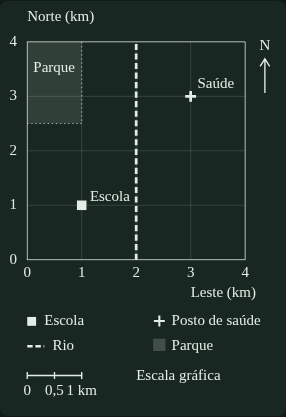
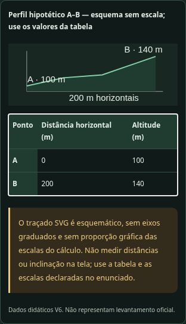

# Cartografia — primeira integração da Base Canônica

Data: 16/10/2026. Branch: `v6-base-canonica`.
Implementação: `8ab19368fb402a606d5645160e67d482ad850b19`.

## Resultado

As três unidades passaram a usar suas bases **`1.0.0`, `APROVADA_CANONICA`**, nesta branch. A build de Cartografia deixou de reextrair os HTMLs e passou a consumir exclusivamente os pacotes aprovados apontados pelo manifesto. Não existe fallback editorial silencioso para candidatas ou HTMLs.

A aprovação é uma decisão de auditoria Premium por **Codex (IA)**, por delegação do usuário, apoiada na [leitura integral](V6_ISSUE13_REVISAO_DELEGADA_CARTOGRAFIA.md) e nas [correções de `0.1.2`](V6_ISSUE13_CORRECOES_CARTOGRAFIA_012.md). O [contrato de revisão delegada](V6_ISSUE13_CONTRATO_REVISAO_DELEGADA.md) registra a autorização e os requisitos. Os campos humanos permaneceram sem preenchimento fictício; não se exige auditoria manual do estudante no GitHub.

Build, **122 testes de integridade/lógica**, **166 cenários globais de navegador** e **25 recálculos do banco operacional** passaram. Após a inspeção visual, duas reconferências sobrepostas validaram o aumento dos rótulos do perfil; não são somadas como novos fluxos aos 166. [Relatório de testes](V6_ISSUE13_TESTES_INTEGRACAO_CARTOGRAFIA.md).

**Esta integração ainda não foi publicada no site.** Não houve merge, execução do workflow de publicação ou alteração das branches `main`, `v6-planejamento` e `v6-piloto-cartografia`. As outras 25 unidades permanecem fora desta auditoria e migração.

## Bases oficiais desta integração

| Unidade | Recursos | Procedências | Parecer |
| --- | ---: | ---: | --- |
| `cartografia-fundamentos@1.0.0` | 277 | 272 | [Auditoria Premium](../base-conhecimento/cartografia/cartografia-fundamentos/1.0.0/audit.md) |
| `cartografia-representacao@1.0.0` | 183 | 172 | [Auditoria Premium](../base-conhecimento/cartografia/cartografia-representacao/1.0.0/audit.md) |
| `geotecnologias@1.0.0` | 231 | 241 | [Auditoria Premium](../base-conhecimento/cartografia/geotecnologias/1.0.0/audit.md) |
| Total | **691** | **685** | Três unidades |

Cada pacote contém conteúdo, suporte, fontes, temporalidade, procedência, deltas completos, parecer nos 12 critérios e decisões por item. O digest de aprovação cobre o pacote; o parecer assistido cobre os recursos individualmente. O carregador exige concordância com o catálogo, habilitação operacional e escopo da delegação. Alterar status ou trocar o conteúdo após o parecer continua sendo rejeitado.

## Paridade e conteúdo

| Recurso | Candidata `0.1.2` | Operacional `1.0.0` |
| --- | ---: | ---: |
| Missões | 17 | 17 |
| Teoria | 50 | 50 |
| Recalls | 39 | 39 |
| Conceitos | 33 | 33 |
| Questões | 161 | 161 |
| Flashcards | 120 | 120 |
| V/F com justificativa | 256 | 256 |
| Discursivas | 6 | 6 |
| Suplementos | 6 | 6 |

**Os textos pedagógicos de `0.1.2` foram preservados:** teoria, enunciados, opções, gabaritos, feedbacks, modelos, variantes, justificativas e suporte. Na promoção mudam status e notas de revisão, decisões editoriais e descrição do contrato de consumo. As diferenças completas estão no `provenance.json` de cada `1.0.0`.

Comparada ao banco inicial do piloto, a integração entrega as correções já auditadas em `0.1.1` e `0.1.2`: 12 associações conceito/missão; explicações de cinco questões na primeira rodada e de 44 na segunda; onze reavaliações de classificação; cinco famílias; fontes e legendas qualificadas; mapa didático autossuficiente; e o distrator de GMS substituído com nova identidade. O conjunto passa de 125 Fixação / 18 Concurso / 18 Elite para **125 / 24 / 12**, sem aumentar a dificuldade por rótulo. Os 161 gabaritos permanecem preservados.

As candidatas anteriores e seus **57 arquivos** permanecem byte a byte iguais. Os **31 HTMLs**, suas cópias publicadas e o snapshot inicial também foram preservados. O [registro de paridade da integração](V6_ISSUE13_PARIDADE_INTEGRACAO.json) mantém as 685 procedências; o relatório histórico do piloto não foi sobrescrito.

## O que o estudante recebe

- As explicações revisadas nas telas de treino e correção.
- O mapa hipotético de Horizonte, com escala gráfica, grade, legenda, tabela e transcrição, sem depender do PDF externo.
- Tabelas e perfil topográfico carregados da base, com a advertência de esquema sem escala ao lado dos dados.
- O par Landsat junto à questão, com datas históricas, sensores, créditos e descrição mesmo quando as imagens não carregam.
- A precisão UTM e as fontes/notas temporais fornecidas pelos pacotes.
- A prática de aula com os campos, instruções e rubricas preservados na base.

Estudo, Treino, Revisão e Prova continuam separados. Temas, teclado, movimento reduzido, modos sensoriais e silêncio em Prova passaram pelos fluxos existentes. Não se inventa novo aceite humano de conforto sensorial.

## Progresso e recompensas

A chave `missaoGeo.v6.cartografia`, o esquema 6 e os IDs canônicos continuam os mesmos. A atualização preserva agenda, rascunhos, leituras, histórico de tentativas, recompensas e conquistas. Antes da primeira reconciliação, tenta guardar uma cópia bruta; registros de erro afetados também têm cópia integral no histórico exportável. A ausência de espaço não elimina o estado em memória.

Evidências novas registram versão editorial, alternativa escolhida e família quando aplicável. Evidências anteriores sem versão recebem identificação do piloto, sem trocar conceito, missão, resposta ou data. Sessões de prova conservam resposta, ordem das alternativas e prazo. Uma aba antiga que volte a gravar progresso também é reconciliada.

Erros vinculados a associações corrigidas não são transferidos ao novo conceito. O registro anterior fica acessível no Caderno Global e na exportação. Se um registro mistura ocorrências compatíveis e incompatíveis, a cópia integral é preservada e apenas as compatíveis ficam no caderno ativo, reabertas de forma conservadora.

A opção histórica `−42,30°` continua no histórico com seu próprio ID; não é convertida em escolha de `−42,05°`. Uma seleção antiga ainda não confirmada exige escolha explícita de uma alternativa atual. O gabarito continua `−42,5°`.

As cinco famílias contam juntas para familiaridade, novidade e diversidade. Uma troca imediata de formulação não libera XP nem nova evidência independente; o histórico de recompensas por IDs anteriores continua sendo respeitado. Duas formulações da mesma família não satisfazem os dois contextos exigidos para erro convertido em domínio.

A estimativa atual exclui associações incompatíveis, evita duplicar familiares próximos e usa as classificações canônicas, preservando o registro original. Por isso seu valor pode mudar na atualização, sem representar aprendizagem nova. Nenhum XP, evidência, data de retenção ou conquista é concedido pela atualização, importação ou recarga.

## Parecer Premium e limites

As três unidades são aprovadas como bases de estudo no recorte de Cartografia, com os 12 critérios e o nível de confiança registrados. Os achados impeditivos recebem decisões individuais por IA; os históricos anteriores não são apagados. A aprovação não se baseia apenas nos testes técnicos.

Permanecem limites identificados:

- dificuldade e discriminação não calibradas empiricamente;
- acesso aos binários externos não confirmado; PDF IBGE complementar, sem falsa verificação gráfica;
- um roteiro de prática de escala compartilhado, sem anunciar três roteiros específicos;
- prova oficial completa ainda indisponível, com outras áreas não migradas e abrangência deste lote limitada a Cartografia;
- fontes temporais com revisão programada, sem atualização automática de fatos;
- persistência local, sem sincronização entre dispositivos.

Não houve perda pedagógica identificada nesta integração. A aprovação canônica é revisão editorial delegada ao assistente, não certificação externa. Alterações editoriais futuras exigem nova versão e nova auditoria; HTMLs históricos continuam como procedência, sem voltar a competir como fonte oficial.

## Publicação

A entrega está preparada na branch de trabalho. A publicação permanece uma decisão separada, pois a orientação anterior do usuário foi manter `main` intacta. Enviar esta branch não dispara o workflow de Pages, que exige execução manual. Esta rodada não efetuou essa execução.
